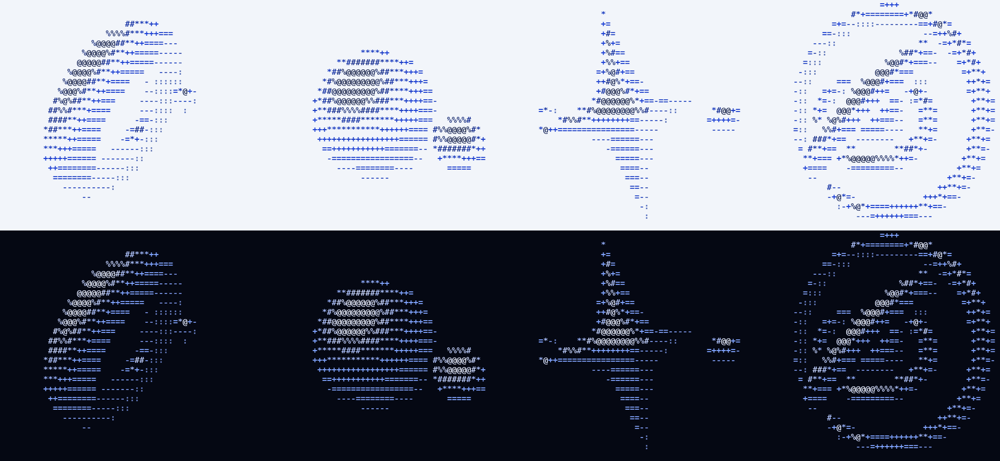

# Loadout

A theme plugin for [Claude Code](https://claude.com/claude-code). One theme picks the whole kit, as a loadout does in a game:

- Claude Code's colours and the terminal background;
- an **Avatar** side pane: a mascot per theme and model, your subagents on a stage, the usage meters;
- a **Flow map** pane: workflow runs, subagents and the step plan, drawn in the theme's style;
- coloured **frames** around conversation rows, one hue per kind of action;
- the **working line**: the theme's own words and a turning icon while Claude works (`★ Inhaling…`).





## Install

In Claude Code:

```
/plugin install loadout --marketplace Zokuzo/loadout
```

Restart Claude Code, then type `/loadout` and pick a theme. That is all: the colour files are installed at the first start.

## The themes

| Theme | Look | Mascot | While it works |
|---|---|---|---|
| `kirby` | Dream Land green, star yellow | Kirby, one copy ability per model | `★ Riding the Warp Star…` |
| `kirby-pink` | Dream Land at dusk: Kirby's pink on deep berry | Kirby | `♥ Napping on a cloud…` |
| `ghostrunner` | Red on near-black, a job journal | A cyber-ninja and a mask | `╱ Wall-running…` |
| `cyberpunk-edgerunners` | Yellow on near-black, a job tracker | A thief and a mask | `◆ Breaching ICE…` |
| `initial-d` | A mountain pass at night: blue-navy dark, headlight white, street-lamp yellow, tail-light red | A camera feed of four drivers where you have added footage; one pixel car per model without | `◴ Running the gutter…` |
| `y2k` | White Y2K, a phone advert of the year 2000: cobalt and glass teal on ice white, the pane's bars shaded as polished metal | Four objects turning in 3D, drawn live in ASCII with depth: a ring and its bead, liquid metal, a star, a ringed core | `✦ Polishing chrome…` |
| `y2k-dark` | The same room with the lights off: periwinkle and aqua on blue-black | The same four, lit for the dark | `✦ Burning a CD…` |
| built-in themes (`dark`, `light`, ...) | Claude Code's own colours | Clawd | `○ Scuttling…` |

## The command

| Typed | Does |
|---|---|
| `/loadout` | Opens the picker in the Avatar pane and lists the themes. |
| `/loadout <theme>` | That theme for every terminal, with no restart. Names are forgiving: `pink`, `ghost`, `edge`. |
| `/loadout <theme> here` | This terminal only. |
| `/loadout frames on\|off` | The frames around conversation rows. |
| `/loadout background on\|off` | Whether the theme tints the terminal background. |
| `/loadout status` | What is set, by what, and from which folder. |
| `/loadout help` | The full list. |

The full reference is [`loadout/README.md`](loadout/README.md).

## Make your own theme

A theme is two JSON files and no code: Claude Code's colours, and a "pack" (background, mascot family, Flow map palette, step style, the working line's words and icon). [`loadout/THEMES.md`](loadout/THEMES.md) walks through one, and `python3 loadout/themes/validate.py` checks it, contrast included.

## Good to know

- Pictures need a terminal with the kitty graphics protocol (kitty, Ghostty). Elsewhere a text version is drawn.
- A theme's background is a solid colour: with a see-through terminal (kitty's `background_opacity` under 1) a light theme turns grey. Set it to `1.0`.
- The plugin is written against Claude Code's plugin hooks (`ui.render`, panes). It needs a recent Claude Code.
- The Y2K themes' mascots are no pictures: each frame is computed in the pane and drawn in ASCII characters, so they play in any terminal.
- No footage is shipped for the Ghostrunner and Edgerunners camera feeds: it belongs to its owners, and those themes draw their built-in characters without it. To get the same feeds as the author, follow [`loadout/FOOTAGE.md`](loadout/FOOTAGE.md): each feed's recipe is shipped, and one script cuts the frames from a video of your own.

## Checks

```
cd loadout
python3 themes/validate.py
claude plugin validate .
claude plugin test .
bash tests/launcher.sh
```

## License and credits

The code is under the [MIT license](LICENSE). The pixel art is drawn for this project; where it depicts a character someone else owns, that grant covers the drawing, not the character.

This is an unofficial fan project. Kirby, Ghostrunner, Cyberpunk: Edgerunners, Cyberpunk 2077 and Initial D are the property of their respective owners, and Claude, Claude Code and Clawd are Anthropic's. This project is not affiliated with or endorsed by any of them, and ships none of their assets. The Y2K themes copy no advert, brand or product: their look is the style of that time, in drawings of this project's own.
